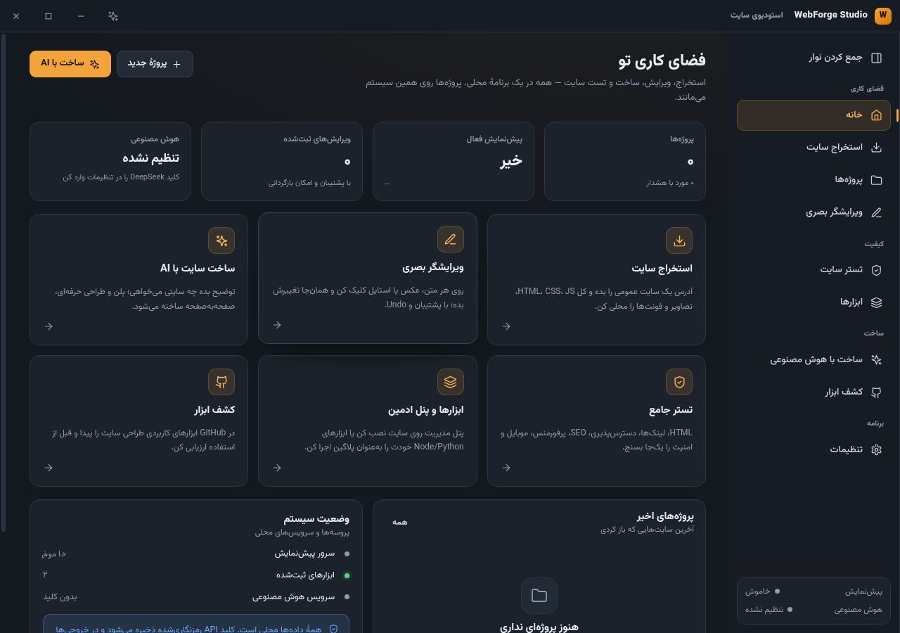

# WebForge Studio

استودیوی دسکتاپ محلی برای **استخراج سایت**، **ویرایش بصری**، **ساخت سایت با هوش مصنوعی**، **اجرای ابزارهای شخصی** و **تست جامع سایت** — با رابط فارسی، RTL و تم تیره/روشن.



> این برنامه برای یک طراح سایت حرفه‌ای روی ویندوز ساخته شده است. همهٔ پروژه‌ها، لاگ‌ها و تنظیمات محلی می‌مانند؛ هیچ سرویس ابری جز DeepSeek (که فقط با کلید و تأیید خودت صدا زده می‌شود) در مسیر کار نیست.

---

## قابلیت‌ها

| بخش | چه می‌کند |
|---|---|
| **استخراج سایت** | HTML، CSS، JS، تصاویر، فونت، ویدیو و `srcset` را با ساختار محلی ذخیره می‌کند؛ مسیرها را بازنویسی می‌کند؛ `mirror/` خام و `clean/` قابل‌اجرا می‌سازد؛ مانیفست و گزارش هشدار می‌دهد. حالت «رندرشده» برای سایت‌های JavaScript‌دار هم دارد. |
| **ورود پروژهٔ محلی** | پوشه را انتخاب می‌کنی، برنامه نوع/entry/تعداد صفحات/فریم‌ورک را اسکن می‌کند و بعد از تأیید، پروژه در ویرایشگر و تستر ظاهر می‌شود. |
| **ویرایشگر بصری** | پیش‌نمایش محلی + کلیک روی هر عنصر؛ سه تب محتوا/استایل/ساختار: متن، رنگ و باکس‌مدل، کلاس، ویژگی‌های `data-*`، درج و حذف HTML. ذخیرهٔ جراحی‌شده در همان فایل HTML با پشتیبان زمان‌دار، Undo/Redo و تاریخچه؛ حالت انتخاب بعد از هر ذخیره حفظ می‌شود. اسکریپت‌های خود سایت به‌طور پیش‌فرض در پیش‌نمایش نگه داشته می‌شوند تا چیزی که کلیک می‌کنی همان فایلی باشد که ذخیره می‌شود (با سوییچ «اسکریپت‌های سایت» برای حالت زنده). |
| **پنل ادمین** | ابزار «سازنده پنل ادمین» را روی هر سایت استاتیک نصب می‌کند؛ پنل با API سازگار داخلی (`/api/content` و `/api/upload`) روی ویندوز/لینوکس کار می‌کند. |
| **ساخت با AI** | پلن سایت (برند، پالت، تایپوگرافی، صفحات) → تأیید → تولید قطعی `tokens.css` و پوسته → تولید صفحه‌به‌صفحه با DeepSeek؛ خروجی کامل، بدون CDN و اسکریپت خارجی. |
| **تستر جامع** | HTML، لینک‌ها، دسترس‌پذیری با axe-core (WCAG 2.2 AA)، SEO، کنسول، پرفورمنس، ریسپانسیو و امنیت پایه؛ گزارش JSON و امتیاز. |
| **ابزارها (Plugins)** | مانیفست JSON، فرم فارسی خودکار، اجرای Node/Python/EXE/Shell، لاگ زنده، تایم‌اوت، لغو، مجوز شبکه/نوشتن، نصب وابستگی با `--ignore-scripts` و تاریخچه. |
| **کشف و اتصال ابزار** | جستجوی GitHub → بازرسی خودکار (دانلود امن، اسکن اسکریپت/هوک/باینری، سطح ریسک) → هوش مصنوعی طرح اتصال می‌چیند (`npx`، Python، پروژهٔ استاتیک یا دستور دستی) و برنامه فقط با فایل‌ها و پیکره‌هایی که روی دیسک تأیید شده‌اند جلو می‌رود؛ ابزاری که کد اجرا می‌کند و ریسکش بالاست بدون تأیید صریح متصل نمی‌شود. |
| **تنظیمات** | تم دارک/لایت/سیستم، مسیر پروژه‌ها، بازهٔ پورت، محدودیت‌های استخراج، کلید DeepSeek رمزنگاری‌شده، خروجی JSON و عیب‌یابی. |

نماهای بیشتر: [ویرایشگر](docs/screenshots/workspace.png) · [تستر](docs/screenshots/qa.png) · [تم روشن](docs/screenshots/settings-light.png)

---

## شروع سریع

### ویندوز (فایل آمادهٔ اجرا)

1. `release/WebForge Studio-1.2.1-x64.exe` را اجرا و نصب کن، یا `release/WebForge Studio-1.2.1-portable.exe` را بدون نصب باز کن.
2. یا پوشهٔ `release/win-unpacked` را باز کن و `WebForge Studio.exe` را بزن.
3. در تنظیمات، مسیر پروژه‌ها را بررسی کن.
4. برای AI، کلید DeepSeek را در **تنظیمات → هوش مصنوعی** وارد کن (رمزنگاری‌شده با DPAPI ویندوز).

> فایل‌ها امضای دیجیتال ندارند؛ ویندوز SmartScreen ممکن است هشدار بدهد. برای توزیع عمومی باید گواهی کد امضا اضافه شود.

### اجرای توسعه

پیش‌نیاز: **Node.js ‏22.12 یا جدیدتر** (دیتابیس از `node:sqlite` builtin استفاده می‌کند).
هیچ وابستگی بومی/C++ نصب نمی‌شود، پس ابزار کامپایل لازم نیست.
اگر سیاست `allow-scripts` npm مانع دانلود باینری Electron شد، با
`node node_modules/electron/install.js` دانلودش کن.

```bash
npm install
npm run dev
```

### ساخت

```bash
npm run build          # بیلد Electron
npm run package:win    # ویندوز (nsis + portable)
npm run package:linux  # لینوکس AppImage/dir
npm run verify         # typecheck + ۳۶ تست واحد + placeholder gate + build
npm run test:e2e       # ۱۴ سناریوی واقعی روی Electron (+۲ سناریوی اختیاری با اینترنت)
```

---

## یک جریان کاری واقعی

0. **پروژهٔ محلی:** پروژه‌ها → باز کردن پوشه → بررسی و افزودن. در ویرایشگر/تستر ظاهر می‌شود.
1. **استخراج:** آدرس سایت → نام پروژه → «شروع استخراج». نتیجه در `clean/` و مانیفست در ریشهٔ پروژه.
2. **ویرایش:** «باز کردن در ویرایشگر» → «حالت انتخاب» → کلیک روی هر عنصر → تب محتوا/استایل/ساختار → «اعمال استایل‌ها» یا «ذخیرهٔ متن». بعد از ذخیره صفحه reload می‌شود و انتخاب حفظ می‌گردد.
3. **پنل ادمین:** صفحهٔ ابزارها → اجرای «سازنده پنل ادمین» → بعد از نصب، در ویرایشگر مسیر `/admin.html` را باز کن.
4. **کشف ابزار:** «جستجو» → «بازرسی» → گزارش ریسک و «طرح اتصال» که هوش مصنوعی چیده → «اتصال به برنامه» (یا «افزودن به پروژه‌ها» برای سایت/اپ استاتیک).
5. **تست:** صفحهٔ تستر → «اجرای تست» → گزارش در `reports/qa-report.json`.
6. **ساخت با AI:** توضیح سایت → ساخت پلن → بررسی پالت و صفحات → تأیید و ساخت.

---

## ساختار پروژه

```text
webforge-studio/
├─ src/main/                 # Electron main + سرویس‌ها
│  ├─ core/                  # DB (node:sqlite)، لاگ، URL guard، path guard
│  ├─ services/              # extraction, preview, editor, plugins, ai, qa, discovery
│  └─ ipc.ts                 # قرارداد IPC + اعتبارسنجی Zod
├─ src/preload/              # contextBridge محدود
├─ src/renderer/             # React 19 + RTL
├─ src/shared/               # types, schemas, IPC contract
├─ resources/kits/           # پنل ادمین (ابزار خودت)
├─ resources/skills/         # اسکیل‌های قابل‌ویرایش طراحی/استخراج/تست
├─ tests/                    # unit + integration + e2e
└─ docs/                     # ممیزی، پژوهش، تصمیم‌ها، تأیید
```

خروجی هر پروژهٔ استخراج‌شده:

```text
my-site/
├─ mirror/                   # نسخهٔ خام
├─ clean/                    # نسخهٔ قابل‌اجرا/ویرایش
├─ reports/extraction-report.json
├─ webforge.manifest.json
├─ .webforge/backups/…       # پشتیبان هر ویرایش
└─ content.json              # فقط بعد از نصب پنل ادمین
```

---

## امنیت

- `contextIsolation: true`, `nodeIntegration: false`, `sandbox: true` و preload محدود.
- همهٔ ورودی‌های IPC با Zod اعتبارسنجی می‌شوند.
- SSRF guard: فقط `http/https` عمومی؛ loopback، private، link-local، multicast و IPv6 محلی مسدود؛ هر ریدایرکت دوباره بررسی می‌شود.
- همهٔ نوشتن‌ها با `assertInside` به ریشهٔ پروژه محدود می‌شوند.
- کلید DeepSeek با `safeStorage` سیستم رمز می‌شود و هرگز به renderer/لاگ/IPC برنمی‌گردد.
- لاگ‌ها JSONL با redaction کلید/توکن/کوکی هستند.
- فایل دانلودشده هرگز اجرا نمی‌شود؛ JavaScript سایت در سندباکس Chromium اجرا می‌شود.
- پلاگین‌ها با timeout، محیط محدود، لغو و مجوز صریح اجرا می‌شوند. (مسدودسازی شبکه در سطح پروسه best-effort است؛ برای ابزارهای ناشناس از VM/سیستم جدا استفاده کن.)

---

## نوشتن پلاگین

```json
{
  "name": "my-tool",
  "displayName": "ابزار من",
  "description": "توضیح کوتاه",
  "version": "1.0.0",
  "runtime": "node",
  "command": "index.js",
  "args": [],
  "cwd": ".",
  "inputs": [
    { "key": "siteUrl", "label": "آدرس سایت", "type": "url", "required": true },
    { "key": "projectId", "label": "پروژه", "type": "projectPath", "required": true }
  ],
  "outputs": [{ "key": "report", "type": "file", "path": "report.json" }],
  "permissions": { "network": false, "projectWrite": true, "environment": [] },
  "timeoutSeconds": 300
}
```

- فرم فارسی از `inputs` ساخته می‌شود.
- جای‌گذاری `{{siteUrl}}`، `{{projectPath}}` و `{{cwd}}` در `args` پشتیبانی می‌شود.
- خروجی‌های اعلام‌شده باید در `cwd` ساخته شوند، وگرنه اجرا `failed` می‌شود.

---

## هوش مصنوعی

- پیش‌فرض: `deepseek-flash` روی `https://api.deepseek.com`.
- جریان: `SiteSpec` → اعتبارسنجی → `tokens.css` قطعی → پوستهٔ مشترک → بدنهٔ هر صفحه → نوشتن → تست.
- `thinking` غیرفعال، `temperature` فعال، JSON mode برای پلن و SSE برای صفحات.
- کلید فقط در main خوانده می‌شود. هیچ درخواستی بدون کلید یا تأیید پلن ارسال نمی‌شود.
- اسکیل طراحی در `resources/skills/web-design/SKILL.md` قابل ویرایش است و به پرامپت اضافه می‌شود.

---

## تست و شواهد

```text
npm run verify
→ typecheck: OK
→ tests: 39 passed (7 files)
→ placeholder gate: passed
→ build: OK
```

E2E واقعی روی برنامهٔ Electron (Playwright `_electron`) — ۱۷ سناریو در سه فایل:

```text
tests/e2e/app.spec.ts (8 passed)
✓ dashboard/navigation RTL
✓ extraction of a real local site
✓ preview + click-to-edit + persistence + backup
✓ admin panel plugin install
✓ external Node plugin run + logs + output contract
✓ local folder import → editor → QA
✓ QA report generation
✓ theme toggle

tests/e2e/editor-deep.spec.ts (6 passed)
✓ style edit → file + live preview (toHaveCSS)
✓ selection mode survives the reload after a saved edit
✓ in-place text replacement
✓ class add + attribute save/delete (بدون فاصلهٔ اضافه)
✓ insert-after + hide + remove element
✓ undo restores the previous file state

tests/e2e/editor-hydrated.spec.ts (3 passed)
✓ سایتی که باندلش DOM را دوباره می‌سازد: پیش‌نمایش همان فایل را نشان می‌دهد
✓ کلیک و ذخیره روی همان صفحه در فایل نوشته می‌شود
✓ حالت زنده: باندل اجرا می‌شود و برنامه به‌جای ذخیرهٔ غلط، دلیل را درست می‌گوید
```

دو سناریوی اختیاری که واقعاً به GitHub درخواست می‌دهند با متغیر محیطی فعال می‌شوند
(بدون آن به‌عنوان skipped گزارش می‌شوند تا در CI اجرا نشوند):

```bash
WEBFORGE_LIVE_NET=1 npm run test:e2e    # tests/e2e/discover-live.spec.ts
✓ جستجو → باز کردن مخزن → بازرسی → طرح اتصال
✓ مخزن به‌عنوان پروژهٔ قابل‌ویرایش در پوشهٔ پروژه‌ها ساخته می‌شود
```

روی ویندوز واقعی ساخته و اجرا شده: `npm run package:win` → نصب‌کنندهٔ NSIS و نسخهٔ portable، و باینری بسته‌بندی‌شده بالا آمده است.

جزئیات و خروجی واقعی: `docs/VERIFICATION_REPORT.md` و `docs/PROGRESS.md`.

---

## محدودیت‌های شناخته‌شده

- این نسخه روی **ویندوز** ساخته و با E2E واقعی تست شده؛ مسیر لینوکس فقط در CI (`ubuntu`) بررسی می‌شود.
- امضای کد (code signing) ندارد؛ ویندوز موقع اولین اجرای نصب‌کننده هشدار SmartScreen نشان می‌دهد.
- پیش‌نمایش پروژه‌های Node/Next با اسکریپت dev اجرا نمی‌شود؛ فعلاً فقط سایت استاتیک/`clean` سرو می‌شود.
- ادامهٔ خودکار تولید AI (Resume) پیاده نشده؛ فایل‌های نیمه‌کاره حفظ می‌شوند و اجرای دوباره پروژهٔ جدید می‌سازد.
- اتصال خودکار ابزار از طریق هوش مصنوعی انجام می‌شود، اما هر ادعای پلن (فایل، پکیج، متغیر محیطی) قبل از اجرا روی دیسک راستی‌آزمایی می‌شود؛ باز هم ابزار ناشناس را فقط با تأیید خودت نصب یا اجرا کن.
- نصب وابستگی و اجرای ابزار ناشناس در همان کاربر انجام می‌شود؛ برای ریپوی ناشناس از VM جدا استفاده کن.
- ویرایش بصری روی HTML استاتیک است. در سایت‌هایی که محتوا فقط داخل باندل JS است (SPA بدون SSR)، متن در فایل HTML وجود ندارد و ویرایش بصری روی آن‌ها معنا ندارد؛ برنامه همان را درست می‌گوید به‌جای اینکه تغییر را در جای اشتباه ذخیره کند.
- پلاگین‌های ناشناس در همان کاربر اجرا می‌شوند؛ سندباکس OS-level ندارند.
- دانلود پوشه‌های Gofile به ریت‌لیمیت/بلاک IP محیط وابسته است؛ در برخی شبکه‌ها متوقف می‌شود. جزئیات در `docs/TOOL_AUDIT.md`.
- امضای کد و به‌روزرسانی خودکار ندارد.

---

## عیب‌یابی

| مشکل | راه‌حل |
|---|---|
| پنل باز نمی‌شود | پیش‌نمایش را از ویرایشگر اجرا کن؛ `admin.html` فقط از طریق سرور محلی کار می‌کند. |
| «ذخیره نشد» در پنل | سرور پیش‌نمایش باید فعال باشد؛ `content.json` در ریشهٔ سایت ساخته می‌شود. |
| استخراج ناقص | سقف فایل/حجم/زمان را بالا ببر یا حالت رندرشده را فعال کن؛ گزارش هشدارها را ببین. |
| AI خطای کلید می‌دهد | کلید را در تنظیمات دوباره وارد و «تست اتصال» را بزن. |
| پورت اشغال است | بازهٔ پورت را در تنظیمات عوض کن؛ برنامه خودش پورت آزاد بعدی را می‌گیرد. |
| فونت فارسی درست نیست | `Vazirmatn.woff2` در بیلد موجود است؛ اگر فایل حذف شده، دوباره از npm/ریپو بگیر. |

لاگ‌ها: `تنظیمات → داده و عیب‌یابی → لاگ‌ها`.

---

## مستندات

- [مشخصات و پوشش نیازمندی‌ها](SPEC.md)
- [نقشهٔ اجرا و وضعیت](PLAN.md) · [پیشرفت](PROGRESS.md)
- [تصمیم‌ها و انحراف‌های فنی](DECISIONS.md)
- [ممیزی چهار ابزار ورودی](docs/TOOL_AUDIT.md)
- [پژوهش GitHub و ابزارهای مکمل](docs/RESEARCH_GITHUB.md)
- [گزارش تأیید واقعی](docs/VERIFICATION_REPORT.md)
- [گزارش محیط](docs/BASELINE_REPORT.md)

## مجوز

کد این پروژه خصوصی است (`UNLICENSED`). بستهٔ پنل ادمین از ابزار خودت آمده و مجوز مستقل خودش را دارد. وابستگی‌ها با مجوزهای MIT/Apache/BSD/MPL استفاده شده‌اند؛ فهرست در `docs/DEPENDENCIES.md`.
